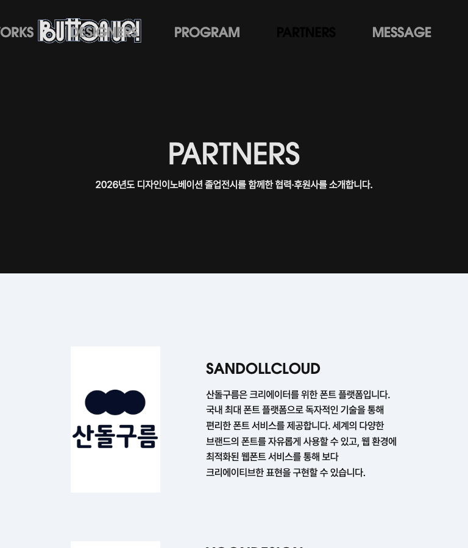
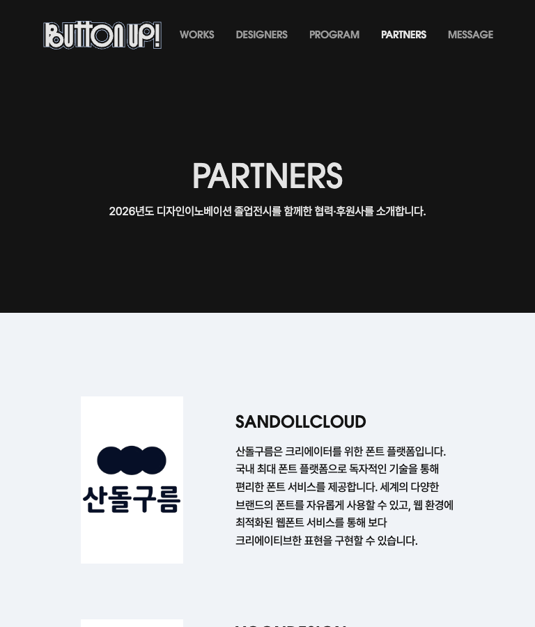

# 반응형 검수 — 2026-10-14

## 최초 검수 결과

일반적인 모바일 및 1280~2560px 데스크톱에서는 검사 대상 페이지의 가로 스크롤, 실행 오류가 발견되지 않았다. 다만 701~900px에서 상단 메뉴가 로고와 겹치는 문제가 확인됐다. 따라서 모든 반응형 구간이 완료됐다고 판단할 수는 없다. 이번 작업은 검수이며 제품 코드를 수정하지 않았다.

## 범위와 방법

- Chrome 브라우저의 화면 크기 모사, 8개 페이지 × 15개 화면 크기 = 120개 조합.
- 홈, 작품 목록, 디자이너 목록, 프로그램, 파트너, 메시지, 작품 상세 1개(망원인 연구소), 디자이너 상세 1개(이준석).
- 크기: 320×740, 375×812, 390×844, 393×852, 440×956, 700×900, 768×1024, 1024×768, 1280×800, 1366×768, 1440×900, 1512×982, 1728×1117, 1920×1080, 2560×1440.
- 인치와 CSS 표시 크기는 일대일 대응이 아니다. 13~14인치 노트북은 1280~1512px, 16인치는 1512~1728px, 27인치 모니터는 1920~2560px 등의 표시 크기를 대표 범위로 삼았다. 기기별 배율과 창 크기에 따라 달라진다.
- 화면 좌우 넘침, 푸터 중심 좌표, 이미지 로딩, 실행 오류 검사. 390/1440/2560px에서 상단·하단 스크린샷 확인.
- 390px에서 주요 8개 페이지의 모바일 메뉴 열기·닫기 확인.
- 메시지는 가상 API 응답으로 검수하여 실제 서버에 테스트 메시지를 게시하지 않았다.

## 앞선 피드백 반영

| 항목 | 결과 |
|---|---|
| 모바일 저작권 중앙 정렬 | 모든 모바일 검사 너비에서 중심 오차 0px |
| 모바일 메시지 입력창 전체 너비 | 좌우 20px 여백, 320~700px에서 정상 |
| 닉네임 2열 점유 | 4열·12px 간격 기준 정상. 390px에서 169px, 440px에서 194px |
| 모바일 MESSAGE 제목·버튼 | 제목 표시, 버튼 우측 정렬 확인 |
| PC 정렬 화살표 | 오른쪽 16px·세로 중앙, 옵션 변경 정상 |
| 메시지 자동 높이·글자 수 | 입력에 따른 증가 및 최대 높이 320px 이후 내부 스크롤 확인 |

데스크톱 저작권은 기존 스타일에 의도적으로 -0.5px 보정이 들어가 있으며 검사 결과도 -0.5px 또는 0px다. 모바일 오차는 0px다.

## 발견한 문제

### 우선 수정: 중간 화면 너비의 상단 메뉴 겹침

- 768px에서 작품·디자이너·프로그램·파트너·메시지 페이지의 상단 메뉴가 왼쪽으로 약 19px 벗어났다.
- 파트너 페이지 추가 검사: 701px에서 메뉴 시작 -86px, 768px에서 -19px, 900px에서 113px. 로고 오른쪽은 약 234px이므로 모두 로고와 겹친다.
- 1024px에서는 메뉴 시작 약 237px로 겹치지는 않지만 로고와의 간격이 약 3px로 지나치게 좁다.
- 1100px에서는 간격 확보. 1101px 이상에서는 공통 데스크톱 메뉴로 전환된다.
- 원인: 모바일 메뉴는 700px 이하, 공통 데스크톱 메뉴는 1101px 이상에 적용되어 중간 구간에 큰 글자와 넓은 간격을 사용하는 기존 메뉴가 남는다.
- 권장: 701~1100px에 메뉴 글자·간격·로고 크기를 조정하는 전용 규칙을 두거나 메뉴 전환 기준을 통합한다. 모바일과 본문 레이아웃의 전환점을 무작정 함께 바꾸지 않는다.

### 재현되지 않은 로딩 기록

2560px 작품 목록 검사에서 모바일 메뉴 SVG 로딩 실패가 한 번 기록됐다. 파일은 존재하며 재검사에서는 깨진 이미지가 0개였다. 지속적인 파일 누락으로 판단할 근거는 없다.

## 동작 확인

- 메시지 초기 12개 → 더 보기 15개 정상.
- 오래된순 선택 후 순서 변경 정상.
- 175자 입력 시 175 / 300 표시, 긴 입력에서 내부 스크롤 정상.
- 가상 전송 1회, 성공 안내·폼 초기화·버튼 문구 복구 정상.
- 홈 모바일 영상 재생 준비 상태 정상, 실제 재생 시간이 증가하는 것 확인.

## 제한

로컬 코드의 Chrome 검수다. 실제 Safari/iPhone/Android/Firefox와 배포 서버 환경, 모든 작품·디자이너 개별 상세 콘텐츠, 실제 API 저장·권한·오류 응답, 실기기 영상 성능, 모든 스크롤 위치의 픽셀 단위 비교까지 보증하지 않는다. 피그마 전체 화면 대조는 수행하지 않았으며 이 대화에서 요청한 피드백 항목을 중심으로 확인했다.

원시 측정값: [results.json](results.json)

## 수정 후 재검수

701~1100px의 기본 상단 메뉴에 공통 반응형 규칙을 적용했다. 기존 174.08×41px 로고와 좌우 60px 여백을 유지하며, 로고 뒤 24px부터 남은 너비에 메뉴를 배치한다. 서체는 기존 Avant Garde를 유지하고 크기는 14~18px로 화면에 맞춰 변화한다. 어두운 페이지의 현재 메뉴는 기존 밝은 색 #e4e4e4를 사용해 식별 가능하게 했다. 모바일 700px 이하와 데스크톱 1101px 이상의 스타일은 변경하지 않았다. 공통 CSS 참조 버전도 갱신했다.

- 재검수: 8개 페이지 × 13개 너비 = 104개 조합.
- 너비: 390, 700, 701, 720, 768, 900, 1024, 1100, 1101, 1280, 1512, 1728, 2560px.
- 표시된 메뉴 항목과 로고의 겹침 0건, 메뉴 항목끼리 겹침 0건, 메뉴 화면 이탈 0건, 문서 가로 넘침 0건.
- 701/768/1024px 파트너 페이지의 수정 후 화면도 확인했다.
- 최초 보고서의 중간 너비 메뉴 문제는 수정 완료다. 실기기·다른 브라우저 관련 검수 제한은 동일하다.

재검수 원시 측정값: [recheck.json](recheck.json)
